# NestNotes – Flat Sharing Platform

NestNotes is a full-stack flat-sharing and rental platform that helps users discover properties, connect with owners, express interest in listings, manage favorites, and communicate through an integrated messaging system.

**Version:** 1.0
**Project Type:** Full-Stack Development Portfolio Project

## Features

### Authentication and Authorization
- User registration and login
- Password hashing using bcryptjs
- JWT-based authentication
- Protected API routes
- Listing ownership checks
- Role-based authorization for admin routes

### Property Listings
- Create, view, edit, and delete listings
- Listing details including rent, location, category, and description
- Image uploads using Multer
- Listing verification functionality
- Search, filtering, and rent-based sorting

### User Features
- User profiles
- Favorites management
- Express interest in properties
- View interested users
- Dashboard statistics

### Messaging and Notifications
- Direct messaging
- Owner inbox
- Message replies
- Chat interface
- Notifications for supported application events

### Administration
- View property listings
- Verify and unverify listings
- Role-protected administrative endpoints

## Technology Stack

| Layer | Technologies |
|---|---|
| Frontend | HTML5, CSS3, JavaScript (ES6+) |
| Backend | Node.js, Express.js |
| Database | SQLite |
| Authentication | JSON Web Tokens (JWT), bcryptjs |
| File Uploads | Multer |
| Testing | Jest, Supertest |

## Project Structure

```text
NestNotes-Flat-Sharing/
├── frontend/
├── backend/
│   ├── routes/
│   ├── middleware/
│   ├── tests/
│   ├── database.js
│   ├── server.js
│   └── package.json
├── docs/
└── README.md
```

*The structure above is representative. Update it if your actual repository differs.*

## Getting Started

### Prerequisites

- Node.js and npm
- Git
- A modern web browser

### 1. Clone the Repository

Replace the placeholder below with your actual GitHub repository URL.

```bash
git clone <your-github-repository-url>
cd NestNotes-Flat-Sharing
```

### 2. Install Backend Dependencies

```bash
cd backend
npm install
```

### 3. Configure Environment Variables

Review the backend configuration before running the application. Keep secrets, production credentials, and private configuration out of Git.

If your application uses environment variables, document their names and provide a safe `.env.example` file with placeholder values.

### 4. Start the Backend

```bash
npm start
```

If the project does not define a `start` script, use the appropriate command from `backend/package.json`, such as:

```bash
node server.js
```

The local API is expected to run at:

```text
http://localhost:3000
```

### 5. Open the Frontend

Open `frontend/index.html` using VS Code Live Server or another local static web server.

Make sure the frontend's API base URL matches the backend environment you intend to use.

## API Modules

The backend includes the following API modules:

- **Authentication:** registration and login
- **Listings:** property discovery and listing management
- **Interests:** property-interest operations
- **Messages:** messaging and replies
- **Profiles:** user profile operations
- **Admin:** administrative listing operations
- **Notifications:** notification operations

Refer to the backend route files for the implemented endpoints, HTTP methods, request bodies, and authentication requirements.

Authenticated endpoints use a JWT bearer token where required:

```http
Authorization: Bearer <your-jwt-token>
```

## Testing

Run the backend test suite from the `backend/` directory:

```bash
npm test
```

The current reported test result is **5 passing tests across 2 test suites**.

The suite includes listing endpoint checks, ownership-authorization checks, and an admin-access check. The security tests use a mocked database for the simulated ownership scenarios.

Run the tests again before publishing to confirm the current result.

## Screenshots

Add screenshots of the actual working application to the `screenshots/` directory.

### Home Page

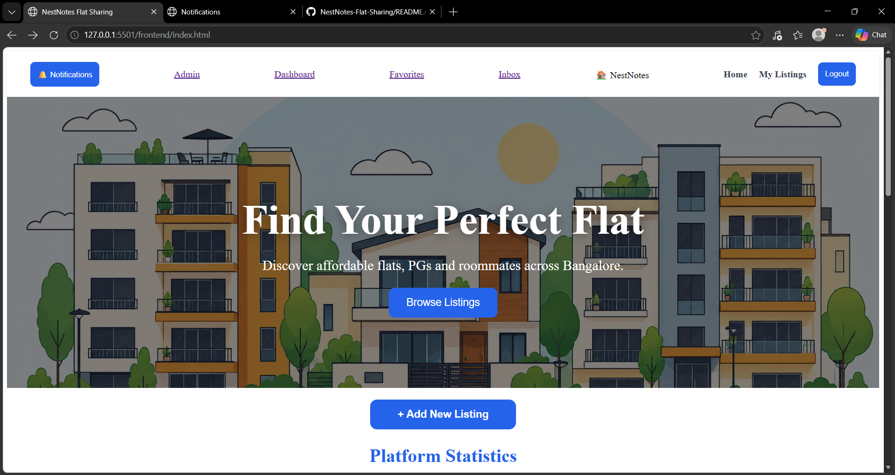

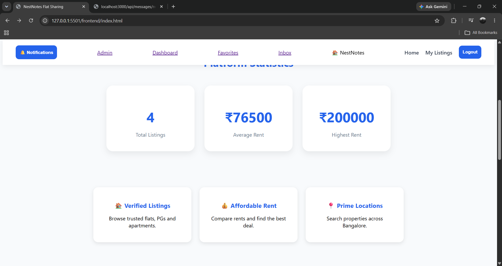

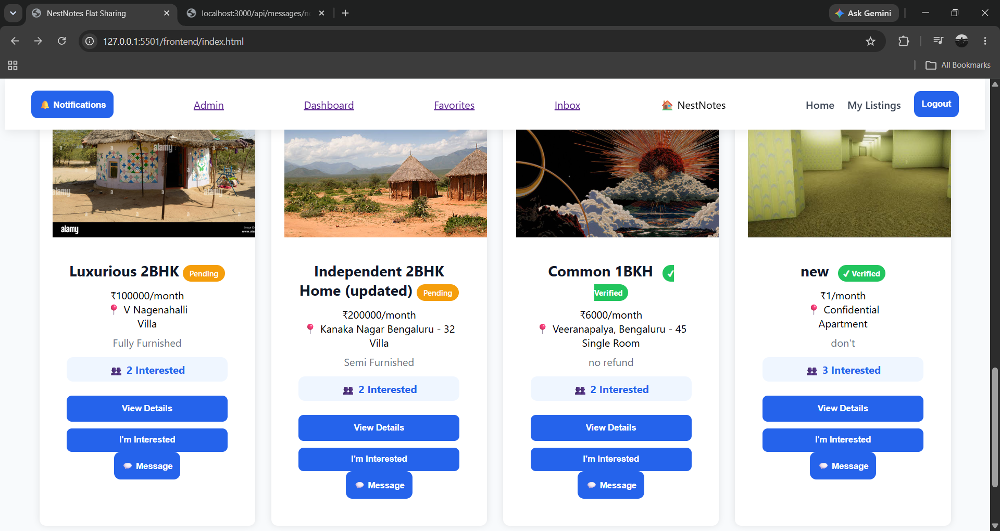

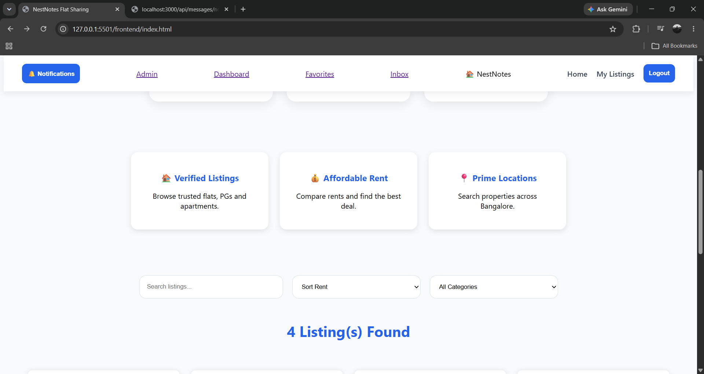

### Dashboards

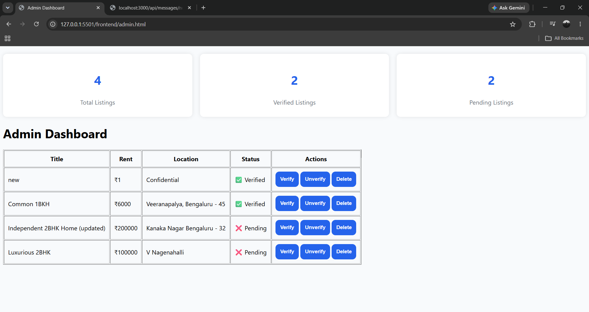

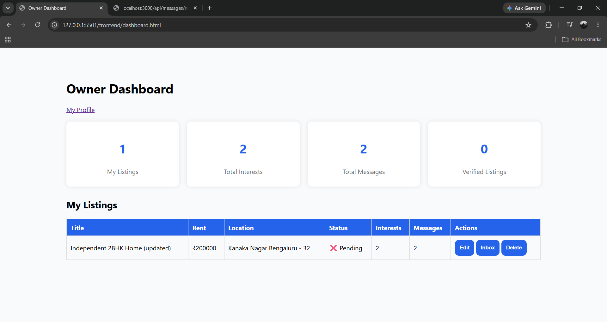

### Authentication

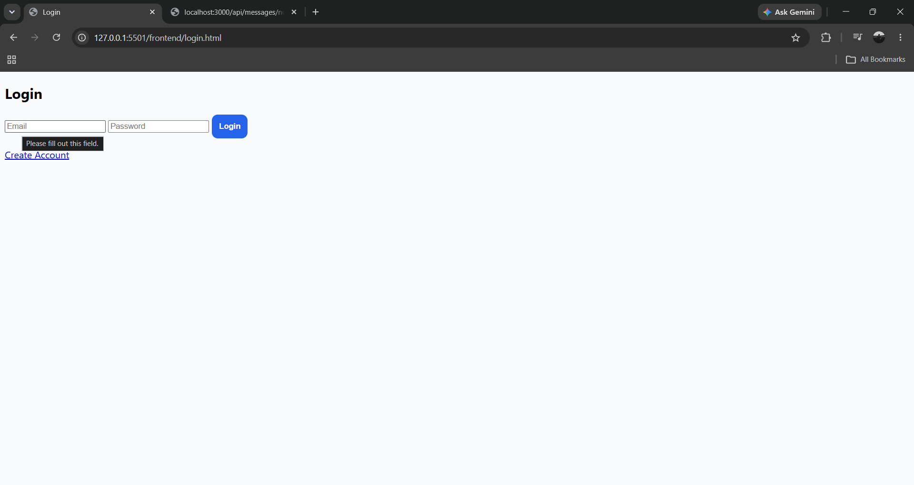

### Messaging and Notifications

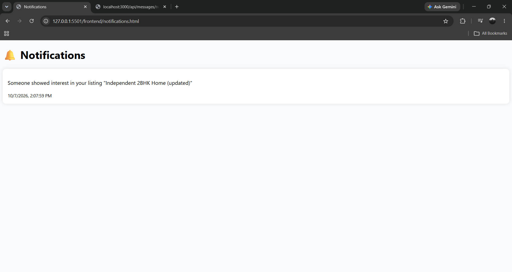

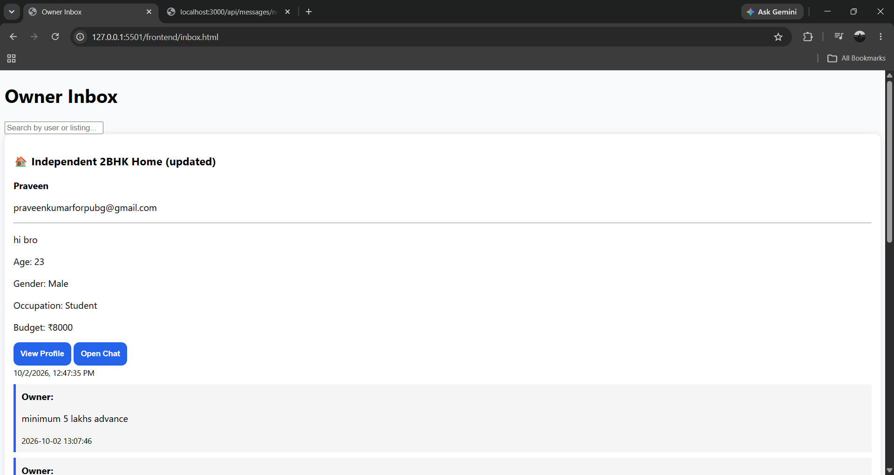

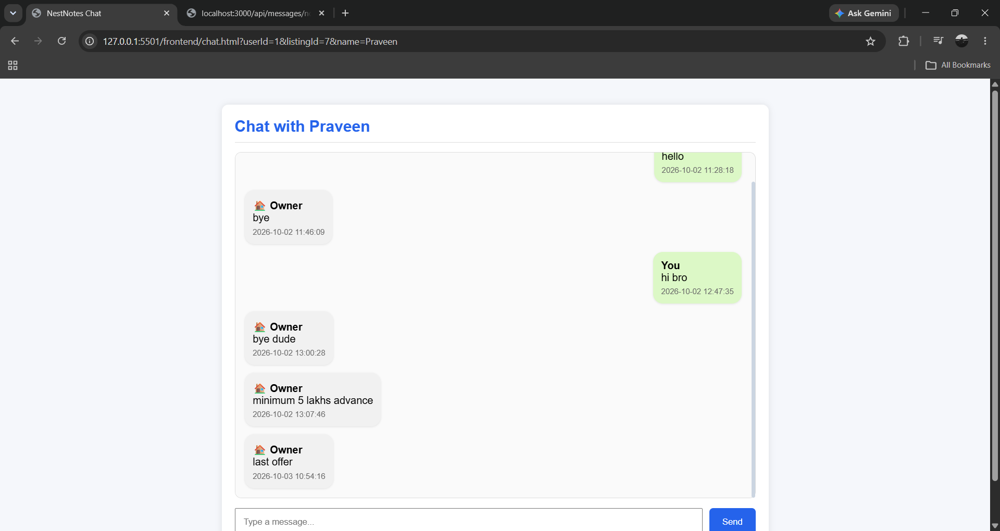

### User Listings

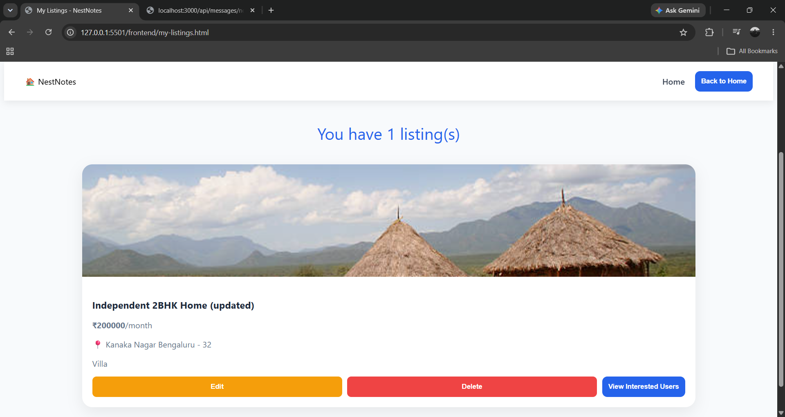

*Ensure each image exists at the specified path. Remove any screenshot reference that is unavailable or no longer reflects the current application.*

## Future Improvements

Potential improvements include:

- Enhanced mobile responsiveness
- Real-time messaging
- Email notifications
- Advanced search filters
- Map integration
- Cloud-based image storage

## Author

**Praveen Kumar**
BCA Student | Full-Stack Development Intern

## License

Educational / Portfolio Project.

If you choose an open-source license for public reuse, add the corresponding license file and update this section accordingly.
